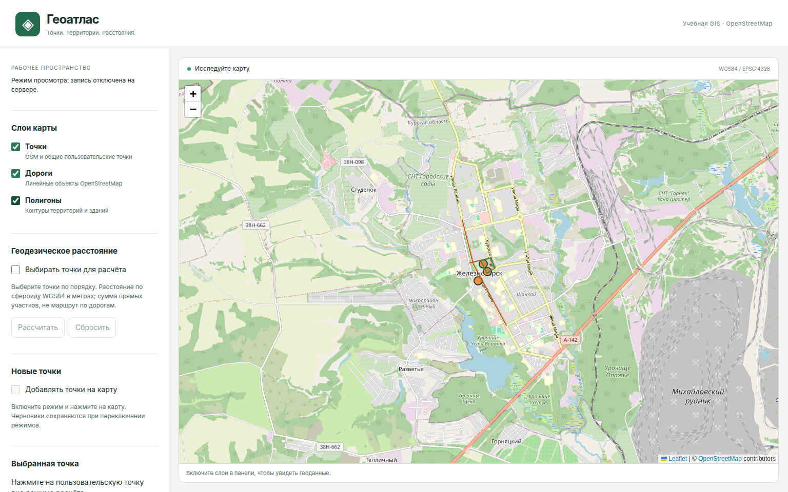
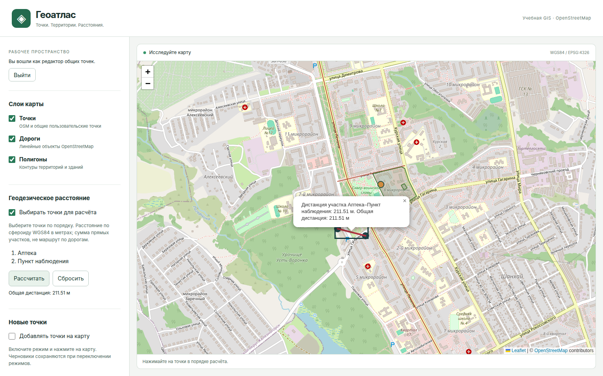

# Геоатлас · Leaflet + PostGIS

[](https://github.com/Kenedy228/leaflet-geojson/actions/workflows/ci.yml?query=branch%3Astage)

Учебное GIS-приложение для курсовой работы 4 курса и GitHub-портфолио.
Показывает геоданные OpenStreetMap, сохраняет общие пользовательские точки
и вычисляет геодезические расстояния. Frontend, API и локальная БД запускаются
из одного монорепозитория; личная БД автора и большой OSM-импорт не нужны.

- Просмотр точек, дорог и полигонов по области карты с ограниченной детализацией.
- Создание точек кликом или координатной формой, пакетное сохранение и удаление.
- Выбор последовательности точек и расчёт сегментов/общей дистанции в метрах.
- Просмотр без входа; редактирование общих точек через серверную сессию и CSRF.



Данные и фон на обоих снимках: © [OpenStreetMap contributors](https://www.openstreetmap.org/copyright),
[ODbL 1.0](https://opendatacommons.org/licenses/odbl/1-0/).
Скриншоты сняты с работающего приложения. [Сценарий презентации и условия съёмки](docs/demo.md).

## Стек и устройство

| Часть | Технологии |
| --- | --- |
| Frontend | Svelte 5, TypeScript strict, Vite, Leaflet 1.9.4 |
| Backend | Java 25, Spring Boot 3.5.7, Spring Security, JdbcTemplate |
| Данные | PostgreSQL 17 / PostGIS 3.5, Flyway, Docker Compose |
| Проверки | Vitest, ESLint/Prettier, JUnit/PostGIS, OpenAPI 3.1, Playwright/Chromium |

Maven строит frontend и включает только Vite `dist` в JAR. Spring Boot обслуживает
UI и API с одного origin. PostGIS выполняет пространственные запросы и вычисления;
Node нужен при разработке/сборке, готовому JAR он не требуется.
[Архитектура, потоки и обоснования решений](docs/architecture.md).

```text
frontend/    Svelte/TypeScript, Leaflet, transport и browser/contract tests
backend/     Spring Boot API, Flyway и интеграционные тесты
infra/       Compose, команды окружения, backup/restore и инструкции импорта
docs/        Архитектура, модель данных, OpenAPI, проверяемые примеры и ограничения
Makefile     Общие команды из корня репозитория
AGENTS.md    Правила реализации, проверки и Git workflow
```

## Быстрый старт

Нужны следующие инструменты; локальный запуск проверен на Linux x86_64:

| Инструмент | Версия |
| --- | --- |
| Java | **Полный JDK 25**, включая `javac`; в CI — Temurin 25.0.5+8 |
| Node.js | **22.23.4**, закреплён в [frontend/.node-version](frontend/.node-version); npm входит в установку |
| Python | 3.10+ |
| Make | GNU Make |
| Docker | Работающий Engine/Desktop и Compose **2.20+** с `up --wait` |

Maven устанавливать отдельно не нужно: используется Wrapper 3.9.11.
Первый запуск требует сети для Maven/npm и образа PostGIS; тайловый фон карты
также загружается из внешнего сервиса OSM.

Рабочая версия монорепозитория находится в `stage`; клонируй именно эту ветку:

```sh
git clone --branch stage https://github.com/Kenedy228/leaflet-geojson.git
cd leaflet-geojson
make init-env
make dev
```

`init-env` создаёт приватную `.env` со случайным паролем БД и сохраняет существующий
файл. `dev` поднимает локальный PostGIS, применяет Flyway, включает demo и собирает
frontend. Дополнительный SQL, ручной импорт и Live Server не требуются.

| Что открыть | Адрес по умолчанию |
| --- | --- |
| Интерфейс | http://localhost:8080 |
| Пример API точек | http://localhost:8080/api/v1/osm/points |
| Готовность приложения и БД | http://localhost:8080/actuator/health/readiness |

Ожидай JSON-событие `application_ready`; readiness должен отвечать HTTP 200
и `{"status":"UP"}`. `SERVER_PORT` меняет общий адрес UI/API, `DB_PORT` — порт БД.
Запросы frontend используют относительный `/api/v1/osm`.

По умолчанию приложение работает **только для просмотра**, включая demo.
Для записи останови приложение (`Ctrl+C`), выполни и запусти его снова:

```sh
make init-editor
make dev
```

Нажми «Войти как редактор». Имя и сгенерированный пароль находятся в собственной
приватной `.env` (`EDITOR_USERNAME`, `EDITOR_PASSWORD`); команда пароль не выводит.
Входи на том же origin, где открыт UI. [Права, сессии и CSRF](docs/access-control.md).

## Проверить основные сценарии

1. Включи точки, дороги и полигоны: demo содержит 3 точки, 2 дороги и 2 полигона
   Железногорска. Перемещение/масштаб карты обновляет область выборки.
2. Войди редактором, включи добавление и создай точку кликом или кнопкой
   «Добавить по координатам». Укажи название, сохрани и обнови страницу.
3. Включи расчёт расстояния и выбери две сохранённые точки. Выполни расчёт:
   появятся сегмент и сумма в метрах. Сбрось выбор перед следующим расчётом.
4. Выключи режим расстояния, выбери свою точку и удали её. После обновления
   страницы она должна отсутствовать; OSM-точки доступны только для чтения.



Дистанция — сумма геодезических отрезков на сфероиде WGS84. Дорожная сеть
не используется для построения маршрута. Расширенный [демо-сценарий](docs/demo.md)
и [HTTP-примеры с успешными и ошибочными ответами](docs/api.md) доступны отдельно.

## Остановка, повторный запуск и данные

`Ctrl+C` останавливает приложение; БД продолжает работать. Из другого терминала
в том же каталоге:

```sh
make db-down       # Остановить локальную БД, сохранив volume
make dev           # Повторный запуск с теми же данными
```

При работающей БД в отдельном терминале можно восстановить demo reference-строки:

```sh
make db-reset-demo
```

Миграции создают `app.user_points` с UUID в EPSG:4326 и OSM-reference таблицы
в `public` с EPSG:3857. Demo seed поставляется в репозитории и при запуске
не скачивает геоданные. Сброс demo сохраняет пользовательские точки и отказывается
менять чужой OSM-импорт. Обычный `make run` использует окружение/`.env`, запускает
API/frontend без включения demo и не поднимает БД автоматически.

`make db-backup` создаёт приватную копию. Восстановление заменяет состояние БД:
оно требует остановленного backend, доверенного файла и `CONFIRM_RESTORE=YES`.
[Backup/restore, сохранность данных и необязательный полный OSM-импорт](infra/README.md).
Полный PBF не нужен для demo. Legacy-точки переносятся по
[отдельной проверяемой процедуре](docs/user-points.md), автоматически перенос не запускается.

## Конфигурация

Безопасный шаблон — [.env.example](.env.example). `.env` читается Python как данные,
окружение имеет приоритет. Не исполняй файл через `. ./.env` и не публикуй его.
Значения с пробелами или `#` заключай в кавычки; shell-подстановки не поддерживаются.

| Переменная | Назначение / значение по умолчанию |
| --- | --- |
| `DB_HOST` | `127.0.0.1`, хост для обычного `make run` |
| `DB_PORT` | `5432`, локальный порт PostGIS |
| `DB_NAME`, `DB_USER` | `gis`, БД и пользователь контейнера |
| `DB_PASSWORD` | Создаётся `make init-env`; в шаблоне безопасная заглушка |
| `DB_URL` | Необязательный JDBC URL внешней БД для `make run`; `make dev` использует свой Compose |
| `SERVER_PORT` | `8080`, общий порт UI/API |
| `CORS_ALLOWED_ORIGINS` | Пусто по умолчанию; точный allowlist для отдельного браузерного клиента API |
| `EDITING_ENABLED` | `false`; серверный запрет записи независимо от роли |
| `EDITOR_USERNAME` | `editor`, имя локального редактора |
| `EDITOR_PASSWORD` | Задаётся в приватной `.env` командой `make init-editor` |

Дополнительно: `API_PROXY_TARGET` — адрес backend для Vite HMR;
`COMPOSE_PROJECT_NAME` — независимый Compose-контур; `MAVEN_ARGS` — Maven-флаги.
`TEST_DB_*` — явное подключение **отдельной тестовой** БД; штатные проверки
автоматически создают собственные БД. Форматы, приоритеты и CORS — в [infra](infra/README.md),
настройка Vite — в [frontend.md](docs/frontend.md). Секреты не передаются через `VITE_*`.

## Сборка и проверки

Все команды — из корня. После первого `make dev` frontend-зависимости установлены.
Для проверок сразу из чистого checkout сначала выполни:

```sh
make install-browser
# На Linux при отсутствии системных библиотек Chromium:
# npm --prefix frontend exec -- playwright install --with-deps chromium
make ci
```

| Команда | Что проверяет или запускает |
| --- | --- |
| `make build` | Vite build и JAR: `backend/target/gis-0.0.1-SNAPSHOT.jar` |
| `make check` | OpenAPI, строгие Svelte/TypeScript, синтаксис Python, Git whitespace |
| `make lint`, `make format-check` | ESLint, Prettier и Spotless; `make format` применяет формат |
| `make test-frontend`, `make test-infra` | Vitest и CLI unit-тесты, без Docker |
| `make test`, `make verify` | Тесты с настоящим изолированным PostGIS; `verify` также проверяет и строит JAR |
| `make check-openapi`, `make test-contract` | Структура/примеры OpenAPI и реальные HTTP-ответы на своей БД |
| `make test-diagnostics` | Запуск, корреляция ошибок, отказ/восстановление БД и graceful shutdown |
| `make test-browser` | Реальные Chromium-сценарии UI/API/PostGIS, включая XSS, гонки ответов и клавиатуру |
| `make ci` | Полный последовательный набор, как в GitHub Actions |
| `make benchmark-spatial` | Отдельный воспроизводимый SQL/HTTP/EXPLAIN benchmark |
| `make dev-frontend` | Vite HMR с API proxy; нужен работающий backend |

`make verify` не включает отдельные contract/process/browser runners; `make ci`
включает их все. Для Chromium нужен Docker и установленный браузер. Тестовые
контуры не используют dev-volume и удаляют свои ресурсы после выполнения.
Подробности: [CI](docs/ci.md), [покрытие и эталоны расстояний](docs/testing.md),
[браузерные проверки](docs/browser-tests.md). Остальные команды — `make help`.

При прямом `java -jar` параметры `DB_*` должны находиться в окружении процесса:
JVM сама `.env` не читает. Дополнительные Maven-флаги можно передать, например,
`make build MAVEN_ARGS='-B -ntp'`.

## Если запуск не работает

| Симптом | Что проверить |
| --- | --- |
| Maven не компилирует Java / release 25 unsupported | `JAVA_HOME`, `java --version` и **`javac --version`**; нужен полный JDK 25 |
| Docker недоступен / БД не поднимается | Docker daemon, доступ пользователя, `docker compose version`; занятый порт меняется через `DB_PORT` |
| UI не открывается | Дождись `application_ready`, проверь `SERVER_PORT` и readiness; используй Spring Boot origin |
| Не скачиваются Maven/npm зависимости | Сеть, права cache; доступны `MAVEN_USER_HOME` и `MAVEN_ARGS=-Dmaven.repo.local=/path/to/cache` |
| Ошибка пароля после правки `.env` | Пароль уже созданной PostgreSQL-роли не меняется редактированием файла; процедура — в infra |
| Seed отказывается запускаться | Обнаружен чужой OSM-импорт; запускай его через `make run` без demo и следуй инструкции импорта |
| Запись запрещена | Включён ли редактор, выполнен ли вход на том же origin, обновлён ли CSRF; черновики сохраняются при отказе |
| Слой возвращает 413 | Сузь область/увеличь zoom; сервер не выдаёт незаметно обрезанный результат |
| Нет фоновых тайлов | Нужен доступ к внешнему OSM tile service; локальные векторы и операции доступны отдельно |

Для серверной ошибки сохрани HTTP-статус и `X-Request-ID`.
[Диагностика запуска и БД](docs/diagnostics.md) описывает безопасные категории;
пароли, cookie и `.env` для сообщения о проблеме не нужны.

## Документация и ограничения

- [Архитектура и потоки](docs/architecture.md), [модель данных и миграции](docs/data-model.md).
- [OpenAPI 3.1](docs/openapi.json), [HTTP-примеры](docs/api.md), [ошибки и валидация](docs/api-errors.md).
- [Frontend и dev proxy](docs/frontend.md), [доступ](docs/access-control.md), [геовыборки](docs/spatial-queries.md).
- [Критерии готовности, измерения и известные ограничения](docs/readiness.md).
- [Roadmap #20](https://github.com/Kenedy228/leaflet-geojson/issues/20), [AGENTS.md](AGENTS.md), [происхождение исходников](docs/migration.md).

Пользовательские точки общие; черновики находятся в памяти страницы. Нет
маршрутизации по дорогам, персонального владения точками и idempotency key записи.
Выборка ограничена 500 объектами на слой и бюджетом вершин; при превышении нужен
меньший viewport. Численные допуски и исторический benchmark не являются SLA.
Проект предназначен для воспроизводимой локальной презентации; публичное
развёртывание в текущую работу не входит.

## Лицензия и геоданные

Код приложения — [MIT](LICENSE), по согласованию с владельцем репозитория.
Полный текст лицензии входит в JAR как `META-INF/LICENSE`.
Зависимости сохраняют собственные лицензионные условия.

Demo: © [OpenStreetMap contributors](https://www.openstreetmap.org/copyright),
[ODbL 1.0](https://opendatacommons.org/licenses/odbl/1-0/). SQL фиксирует источник,
дату, версии объектов и SHA-256 снимка Железногорска от 2026-11-01; персональные
метаданные редакторов не включены. [Происхождение и лицензия данных](infra/README.md#demo-набор-и-лицензия).
Тайлы загружаются с `tile.openstreetmap.org`, атрибуция видима на карте.
