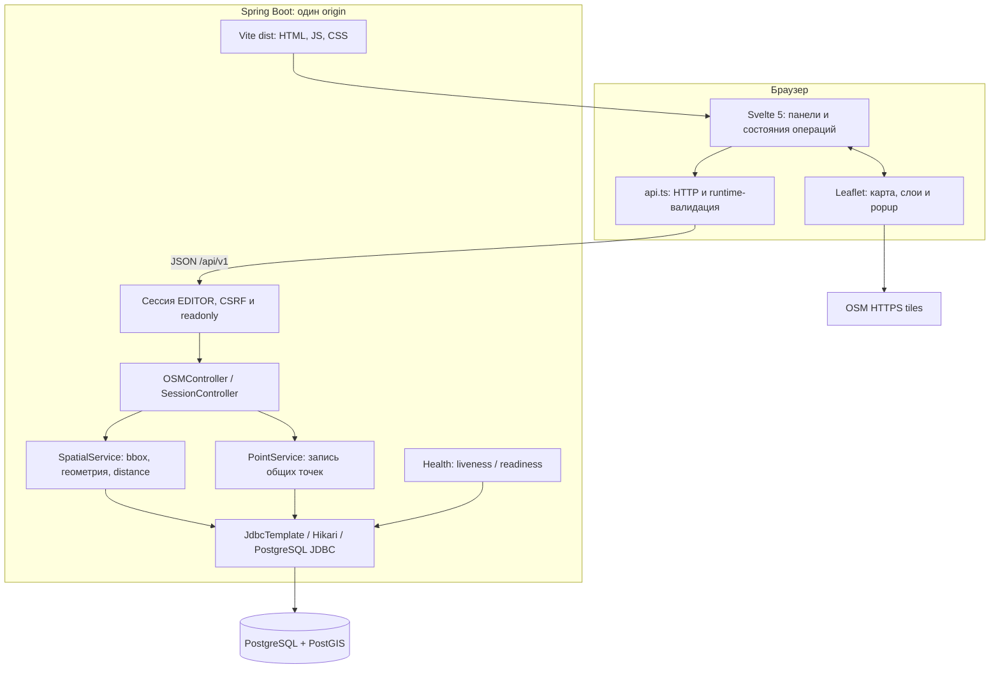
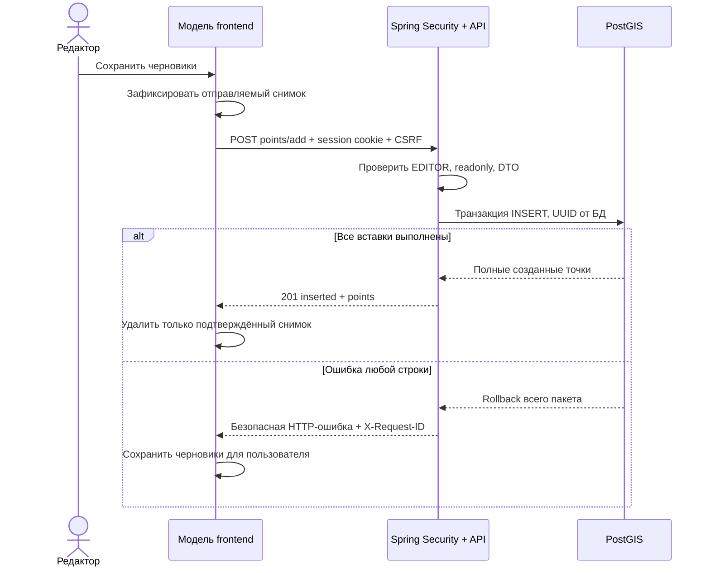

# Архитектура GIS-приложения

Это один локально запускаемый GIS-сервис: браузерный интерфейс, Spring Boot и
PostgreSQL/PostGIS. Исходники frontend и backend находятся в одном репозитории;
Maven собирает Vite bundle и включает его в JAR. На исполнении нужен один
Java-процесс и PostGIS; Node нужен для разработки и сборки.

Тайлы — внешний фон карты. Локальные векторы, запись точек и расчёт расстояния
не обращаются к тайловому сервису. Браузерные тесты отключают загрузку тайлов.
Правила атрибуции и использования сервиса — в [frontend.md](frontend.md).

## Ответственность компонентов

| Компонент | Ответственность и граница |
| --- | --- |
| [App.svelte](../frontend/src/App.svelte), [model.svelte.ts](../frontend/src/lib/model.svelte.ts) | Отдельная модель на экземпляр приложения: режим, слои, черновики, выбор, права и запросы. Данные карты и формы согласуются через неё |
| `frontend/src/lib/LayerControls.svelte`, `DraftEditor.svelte`, `DistancePanel.svelte`, `LeafletMap.svelte` | Отображение и взаимодействие панелей/карты; точные пути компонентов — в [frontend](../frontend/src/lib) |
| [api.ts](../frontend/src/lib/api.ts) и [types.ts](../frontend/src/lib/types.ts) | Независимый клиентский transport: относительные URL, запросы с отменой/таймаутом, проверка внешнего `unknown`, преобразование GeoJSON и DTO |
| [OSMController](../backend/src/main/java/com/github/gis/controllers/OSMController.java) | HTTP-вход: параметры, DTO, вызов сервиса и статус; вычисления и SQL находятся в сервисах |
| [SpatialService](../backend/src/main/java/com/github/gis/geo/SpatialService.java) | Параметризованные PostGIS-запросы, отбор по viewport, лимиты, clipping/simplification и геодезическая дистанция |
| [PointService](../backend/src/main/java/com/github/gis/points/PointService.java) | Валидация пакета/ID, атомарное создание и удаление пользовательских точек; OSM не изменяется |
| [security](../backend/src/main/java/com/github/gis/security) | Опциональный общий редактор, серверная роль, CSRF и session DTO; пароль остаётся на сервере |
| [api](../backend/src/main/java/com/github/gis/api), [config](../backend/src/main/java/com/github/gis/config) | Единый безопасный формат ошибок, строгий JSON и точный необязательный CORS allowlist |
| [diagnostics](../backend/src/main/java/com/github/gis/diagnostics) | Серверная корреляция запросов, безопасные JSON-события и ограниченные probes |
| [Flyway](../backend/src/main/resources/db) и [infra](../infra/README.md) | Версионирование схемы, явные demo-данные, Compose, окружение, backup/restore и импорт |

Сервер использует
JdbcTemplate; наличие starter-data-jpa в [pom.xml](../backend/pom.xml) не означает,
что геозапросы выполняются через ORM. Архитектура не требует общего исходного
типа между Java и TypeScript: wire-контракт фиксируется в [OpenAPI](openapi.json).

## Основные потоки

При pan/zoom Leaflet передаёт bounds и zoom модели. Через debounce 150 мс
запрашиваются включённые слои; старая область немедленно обесценивается.
Backend проверяет bbox/zoom, выбирает данные через пространственные индексы,
проверяет бюджет и возвращает массив DTO. `geojson` внутри DTO — **строка с JSON
геометрии**, а не GeoJSON FeatureCollection. Клиент разбирает и валидирует её
перед созданием Leaflet-слоя. Ошибка не превращается в пустой успешный слой.

Новые черновики, созданные во время запроса, остаются. Подтверждённые записи и
удаления временно учитываются поверх более старого GET, чтобы поздний ответ
не откатил собственную операцию. Новый успешный GET учитывает последующие
изменения других редакторов. Потеря ответа после commit остаётся неопределённым
результатом: ключа идемпотентности нет, автоматического повтора записи нет.

Для дистанции клиент отправляет снимок последовательности `[lng, lat]`.
PostGIS одним SQL вычисляет соседние сегменты на сфероиде WGS84 и их сумму.
Результат содержит `lines` и историческое поле `totalDistance` в метрах.
Это геодезические отрезки между выбранными точками, не маршрут по дорогам.
Преобразование Leaflet `[lat, lng]` выполняется на клиентской границе;
дистанция не вычисляется по экранной проекции или упрощённым линиям дорог.

## Состояние и жизненный цикл

Сохранённые объекты принадлежат серверу; черновики и выбор — текущему экземпляру
UI и не переживают перезагрузку страницы. Добавление и выбор дистанции взаимно
исключаются. Скрытие слоя points сбрасывает выбор дистанции; pan/zoom сохраняет
координатный снимок маршрута и черновики. Logout отнимает право записи, но не
удаляет локальные черновики. Это правила интерфейса, сервер проверяет права
независимо от состояния кнопок.

Запросы используют AbortController и поколения ответов. Отмена не считается
доказательством отмены уже выполненной записи на сервере. Карту создают после
mount; при unmount освобождают карту, обработчики, observer, таймеры и запросы.
Пользовательские строки передаются Leaflet как безопасный DOM с `textContent`.
Подробности инвариантов и проверок — [frontend.md](frontend.md),
[browser-tests.md](browser-tests.md) и [testing.md](testing.md).

## Запуск и доверенные границы

В собранном JAR UI, `/api/v1/osm`, `/api/v1/session`, формы `/login`/`/logout`
и health находятся на одном origin. Session cookie HttpOnly/SameSite=Lax;
запись требует включённого редактора, серверной роли EDITOR и CSRF. Единственное
публичное POST-исключение CSRF — SELECT-only distance. Пользовательские точки
общие; персональных владельцев и регистрации пользователей нет.
[Модель доступа](access-control.md) описывает точные статусы и ротацию CSRF.

В разработке Vite на `127.0.0.1:5173` проксирует `/api`, `/login`, `/logout` к
Spring Boot (`API_PROXY_TARGET`, по умолчанию `127.0.0.1:8080`). Это dev proxy,
а не второй production backend. CORS по умолчанию разрешений не выдаёт;
точный allowlist задаётся только серверным `CORS_ALLOWED_ORIGINS` для API.
База публикуется Compose только на localhost; browser не получает DB-параметры.

`.env` читает Python как данные, окружение имеет приоритет. `make dev` включает
локальную Compose БД и demo; `make run` допускает внешнюю `DB_URL` и не включает
demo автоматически. JVM при прямом запуске JAR `.env` не загружает.
Конфигурация, команды и восстановление — [infra/README.md](../infra/README.md).

## Почему выбран такой подход

| Решение | Обоснование и цена |
| --- | --- |
| Один backend и один JAR | Один локальный запуск, одна HTTP/session граница и атомарная запись в одной БД. Frontend и backend выпускаются вместе |
| Svelte 5 + строгий TypeScript + Vite | Компоненты и реактивное состояние заменяют ручную синхронизацию DOM; strict/runtime-проверки защищают границу API. Для одного экрана отдельный маршрутизатор не требуется |
| Leaflet напрямую | Карта уже решает необходимые задачи; явный lifecycle адаптирует внешние объекты к Svelte. Ответственность за cleanup и безопасные popup остаётся в приложении |
| JdbcTemplate + PostGIS | Пространственные операторы, SRID и лимиты выражены непосредственно в SQL. Приложение отвечает за DTO, параметризацию и транзакции |
| Отдельные reference и user данные | Импорт и demo не владеют пользовательскими точками; API различает происхождение ID. Порядок миграций/импорта нужно соблюдать явно |
| Ручной OpenAPI + исполняемые contract checks | Описывает также Security и health, без генерации API в runtime. Изменение схемы требует проверки реальных ответов; схема не доказывает все предметные инварианты |

Эта документация описывает реализованное устройство. Критерии готовности,
ограничения и условия измерений — [readiness.md](readiness.md), схема данных —
[data-model.md](data-model.md), сценарии HTTP — [api.md](api.md).
