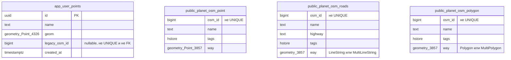

# Модель данных

Приложение разделяет импортированные OSM-слои в `public` и общие пользовательские
точки в `app`. Данные читаются и изменяются SQL-запросами через `JdbcTemplate`.
Этот документ описывает реализованную модель; HTTP-схемы находятся в
[OpenAPI](openapi.json), эксплуатационные команды — в [infra/README.md](../infra/README.md).

## Таблицы и границы владения

На диаграмме нет связей: внешних ключей между этими таблицами нет.
`legacy_osm_id` сохраняет происхождение перенесённой строки, а не ссылку на
существующий OSM-объект. Замена reference-таблиц не требует удаления пользовательских
точек или изменения их UUID. Персонального владельца у точки нет; доступ к записи
определяют серверная сессия редактора, CSRF и `EDITING_ENABLED`, а не поле владельца
в БД. См. [управление доступом](access-control.md).

### Пользовательские точки

Точное определение — [V1__create_user_points.sql](../backend/src/main/resources/db/migration/V1__create_user_points.sql).

| Колонка `app.user_points` | Тип и ограничения | Использование |
| --- | --- | --- |
| `id` | `uuid`, PRIMARY KEY, по умолчанию `gen_random_uuid()` | Серверный идентификатор новой точки |
| `name` | `text NOT NULL`; `char_length(btrim(name))` от 1 до 255 | Название в API и popup |
| `geom` | `geometry(Point,4326) NOT NULL`; не EMPTY; X от −180 до 180, Y от −90 до 90 | Координаты WGS84, пространственная выборка |
| `legacy_osm_id` | nullable `bigint`, без UNIQUE/FK | Служебный прежний ID после явного переноса |
| `created_at` | `timestamptz NOT NULL DEFAULT CURRENT_TIMESTAMP` | Время создания строки, в API точки не выдаётся |

Ограничение названия в БД и валидация HTTP — разные уровни.
[PointService](../backend/src/main/java/com/github/gis/points/PointService.java)
до записи проверяет весь пакет: 1–1000 точек, непустые названия до 255 Unicode
code points без NUL и непарных суррогатов, конечные `lng`/`lat` в диапазонах WGS84.
Проверка `btrim` в SQL не заменяет эти проверки Unicode. Исходное название
сохраняется без автоматического обрезания пробелов. Пакет записывается в одной
транзакции; отказ одной вставки откатывает остальные.

### Импортированные слои

Ниже приведён минимальный контракт таблиц, которые создаёт
[V3__create_osm_reference_tables.sql](../backend/src/main/resources/db/migration/V3__create_osm_reference_tables.sql)
на пустой БД. Внешний импорт может содержать дополнительные колонки и свои
ограничения; эта таблица не является описанием любой существующей OSM-БД.

| Таблица | Колонки, используемые приложением | Геометрия при создании V3 |
| --- | --- | --- |
| `public.planet_osm_point` | `osm_id bigint NOT NULL`, nullable `name text`, `tags hstore` | `way geometry(Point,3857) NOT NULL` |
| `public.planet_osm_roads` | `osm_id bigint NOT NULL`, nullable `name text`, `highway text`, `tags hstore` | `way geometry(Geometry,3857) NOT NULL`; CHECK типа LINESTRING/MULTILINESTRING |
| `public.planet_osm_polygon` | `osm_id bigint NOT NULL`, nullable `name text`, `tags hstore` | `way geometry(Geometry,3857) NOT NULL`; CHECK типа POLYGON/MULTIPOLYGON |

V3 не создаёт PRIMARY KEY или UNIQUE для `osm_id`. Совпадения допустимы:
у старых пользовательских строк были коллизии ID, а импортированные объекты могут
иметь несколько геометрий. Ни знак, ни уникальность `osm_id` не определяют владение.
Для reference-геометрии V3 не задаёт проверки `NOT ST_IsEmpty`, `ST_IsValid`
или диапазонов координат, аналогичные ограничениям `app.user_points`.

При существующих таблицах `CREATE TABLE IF NOT EXISTS` не заменяет их DDL.
V3 добавляет отсутствующие `tags`, проверяет SRID `way` через `Find_SRID` и тип
`tags` (`public.hstore`), создаёт недостающие индексы. Неподходящий SRID или тип
`tags` вызывает отказ вместо скрытой конвертации. Это не полная проверка типов
геометрий, колонок, nullability и качества каждого объекта внешнего импорта.
Перед подключением подготовленной БД нужно отдельно сверить фактическую схему,
геометрии и поля с SQL чтения приложения.

## Индексы

Это индексы, объявленные миграциями репозитория, а не обещание состава индексов
после любого внешнего импорта:

| Таблица | Индекс | Назначение |
| --- | --- | --- |
| `app.user_points` | `user_points_pkey`, UNIQUE B-tree по `id` от PRIMARY KEY | Удаление по UUID, уникальность серверного ID |
| `app.user_points` | `user_points_geom_idx`, GiST по `geom` | Поиск точек в viewport |
| `public.planet_osm_point` | `planet_osm_point_way_idx`, GiST по `way` | Пространственный фильтр |
| `public.planet_osm_roads` | `planet_osm_roads_way_idx`, GiST по `way` | Пространственный фильтр |
| `public.planet_osm_polygon` | `planet_osm_polygon_way_idx`, GiST по `way` | Пространственный фильтр |
| `public.planet_osm_point` | `planet_osm_point_osm_id_idx`, неуникальный B-tree по `osm_id` | Поиск исходных строк при legacy-переносе |

Отдельных индексов по `legacy_osm_id`, `name`, `tags`, road/polygon `osm_id`
миграции не объявляют. V3 использует `IF NOT EXISTS`: совпавшее имя уже имеющегося
индекса не означает проверку его определения. Если импорт пересоздал таблицы после
V3, Flyway не применяет уже записанную версию заново; фактические индексы также
нужно проверить. Лимиты запросов и результаты EXPLAIN описаны в
[spatial-queries.md](spatial-queries.md).

## Представление геометрии и идентификаторов в API

[SpatialService](../backend/src/main/java/com/github/gis/geo/SpatialService.java)
читает OSM-геометрию в EPSG:3857, выполняет пространственный фильтр в этой проекции
и преобразует результат через `ST_Transform(...,4326)`. Пользовательская `geom`
уже хранится в EPSG:4326. Дороги и полигоны перед выдачей обрезаются по viewport
и упрощаются с сохранением топологии; выдача не является точной копией исходной
геометрии в БД. Точки возвращаются без такого упрощения.

В `geojson` находится **JSON-строка** геометрии, а не вложенный объект GeoJSON.
Координаты в ней — `[lng, lat]`. Запрос создания использует именованные `lat`
и `lng`; на SQL-границе `ST_MakePoint` получает сначала longitude.

| Поле точки в API | Значение |
| --- | --- |
| `id` | Непрозрачная строка `osm:<osm_id>` или `user:<uuid>` |
| `source` | `osm` или `user` |
| `osm_id` | Строковое представление `bigint` у OSM-точки; `null` у пользовательской |
| `name`, `geojson` | Название и геометрия |

Клиент передаёт полный `id` обратно при удалении; OSM-точки доступны только для
чтения. Значения `bigint` точек нельзя преобразовывать в JavaScript `Number`:
диапазон БД шире диапазона точных целых JS. Namespace не превращает OSM ID
в уникальный ключ строки БД: дубликаты OSM ID остаются возможными.
В текущей реализации дороги и полигоны выбирают `osm_id` без приведения к text
и выдают его JSON-числом; строковой гарантии точек для этих двух ответов нет.
Различие отражает текущую реализацию, его нельзя скрывать общей формулировкой
«все OSM ID — строки».

Расстояния не хранятся отдельной таблицей. Запрос передаёт 2–1000 координат
`[lng, lat]`, а сервер за один SQL строит `geography` из WGS84 и применяет
`ST_Distance` к последовательным парам. Результат — метры на сфероиде WGS84,
общая дистанция — сумма сегментов; дорожная сеть в расчёте не участвует.
Черновики и выбранная последовательность точек существуют в состоянии frontend,
не как строки БД. Детали API точек — в [user-points.md](user-points.md).

## Flyway, demo и жизненный цикл данных

[Конфигурация](../backend/src/main/resources/application.properties) задаёт
`app` как Flyway schema/default schema. История находится в
`app.flyway_schema_history`; наличие импортированных таблиц в `public` не требует
автоматического `baseline-on-migrate`. Для первого запуска нужны права создания
`app` и объектов; V1 создаёт PostGIS, V3 — hstore в `public`, если расширений ещё нет.
Это требует соответствующих прав PostgreSQL.

| Миграция | Действие |
| --- | --- |
| V1 | `app.user_points`, ограничения и GiST-индекс; PostGIS |
| V2 | Функция явного legacy-переноса; при установке строки не перемещает |
| V3 | Совместимый bootstrap трёх OSM-таблиц, hstore, проверки и индексы |
| `R__reference_dataset.sql` | Repeatable demo seed с явным разрешающим placeholder |

Применённые versioned-миграции не редактируют ради новых изменений схемы.
Demo-миграция доступна Flyway в обычном и demo-профиле, но в обычном профиле
`demo_data_enabled=false` и reference-строки не изменяются.
[Seed](../backend/src/main/resources/db/demo/R__reference_dataset.sql) содержит
3 точки, 2 дороги и 2 полигона из зафиксированного OSM-снимка с атрибуцией ODbL.
В `tags` хранится маркер `leaflet:demo=osm-zheleznogorsk-2026-11-01`.
При включённом demo seed блокирует reference-таблицы, отказывается работать,
если хотя бы одна строка не имеет этого маркера, и атомарно заменяет только
свои строки. `app.user_points` не затрагивается. `make db-reset-demo` использует
тот же SQL; удалять volume или схему `app` для сброса demo нельзя.

### Явный legacy-перенос

[V2](../backend/src/main/resources/db/migration/V2__legacy_point_migration.sql)
устанавливает `app.migrate_legacy_user_points(bigint[])` с правами вызывающего,
без повышения привилегий. Перенос не запускается при старте и не доступен через HTTP.
До него оператор делает backup, останавливает старые writers/импорт, проверяет
происхождение **всех строк** выбранных ID и проверяет операцию на копии БД.
Отрицательный ID — лишь входное ограничение функции, не доказательство происхождения.

Функция принимает непустой список отрицательных ID без `NULL`, удаляет все
совпавшие строки из `planet_osm_point` и вставляет каждую в `app.user_points`
с отдельным UUID, прежним `legacy_osm_id`, именем и `ST_Transform(way,4326)`.
Прочие OSM-атрибуты не переносятся. Удаление и вставка — одна атомарная операция:
при отказе ограничений исходные строки остаются. Повтор для уже перенесённых
строк даёт 0. Проверки и пример управляемой транзакции приведены в
[инструкции переноса](user-points.md#перенос-ранее-добавленных-точек).
Восстановление старого смешанного дампа может снова вернуть исходные строки
и требует сверки, а не автоматического повторного переноса.

### Импорт и восстановление

Для полного импорта используй отдельную подготовленную БД, без demo-профиля.
Порядок из [руководства](../infra/README.md#необязательный-полный-osm-импорт):
сначала запустить миграции через `make run`, остановить приложение, сделать backup,
подготовить отдельную middle-схему `osm_import`, затем импортировать совместимым
профилем osm2pgsql в `public`. Проверить версию импортёра, SRID 3857, `tags hstore`,
колонки и индексы; `--create` пересоздаёт reference-таблицы. Не направлять output
или middle в `app`, не сбрасывать всю БД. После импорта запустить `make run`,
проверить три слоя и сохранность пользовательских UUID/геометрий.
`planet_osm_roads` стандартного профиля — подмножество дорог для low-zoom rendering,
а не все OSM highway-объекты. Полный внешний PBF не является условием demo-запуска.

`make db-backup` создаёт приватный custom-format dump без перезаписи существующего
файла: reference-таблицы, пользовательские точки и Flyway history входят в одну
копию. Восстановление — отдельная замена состояния локальной БД, включая
пользовательские строки, а не способ обновить один OSM-слой. Перед ним остановить
backend, проверить доверенный файл, совместимость версии приложения и целевой
Compose-контур. Команда `make db-restore` требует `BACKUP_FILE` и
`CONFIRM_RESTORE=YES`, выполняет `pg_restore` в одной транзакции; затем запускать
`make run`. Она не предназначена для внешнего `DB_URL`.
Точные команды и условия — в
[руководстве backup/restore](../infra/README.md#резервная-копия-и-восстановление),
реализация — [infra/manage.py](../infra/manage.py).
